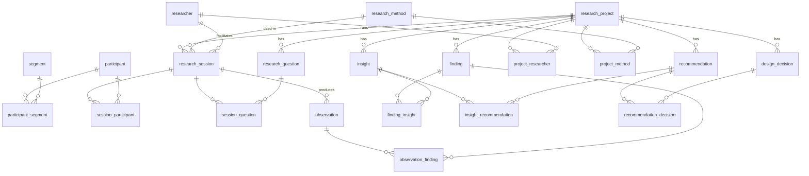

# TRACE database design

PostgreSQL 15+ (Supabase). Table and column names are `snake_case` and match exactly across the SQL files, the JavaScript, and this document.

## Entity–relationship overview

(GitHub renders this diagram automatically.)

## Entities (12)

| Table | Primary key | Key columns | Notes |
| --- | --- | --- | --- |
| `researcher` | `id` | `full_name`, `email` (unique, case-insensitive), `role_title` | People who run research |
| `segment` | `id` | `name` (unique, case-insensitive) | Audience groups |
| `research_method` | `id` | `name` (unique, case-insensitive) | e.g. usability test, card sort |
| `research_project` | `id` | `title` (unique), `research_objective`, `status`, `start_date`, `end_date`, `archived_at` | `archived_at` null means in use |
| `participant` | `id` | `participant_code` (unique, `P-01` format), `age_band`, `notes` | Minimal personal data by design |
| `research_question` | `id` | `project_id` → project, `question_text` | Unique per project |
| `research_session` | `id` | `project_id`, `method_id`, `researcher_id`, `title`, `session_date`, `duration_minutes`, `status` | One facilitator per session |
| `observation` | `id` | `session_id` → session, `title`, `description`, `sentiment` | Project derived through the session |
| `finding` | `id` | `project_id`, `title`, `description`, `confidence` | |
| `insight` | `id` | `project_id`, `title`, `description`, `impact` | |
| `recommendation` | `id` | `project_id`, `title`, `description`, `priority`, `status` | |
| `design_decision` | `id` | `project_id`, `title`, `description` (rationale), `status`, `decided_on` | |

All entity tables use surrogate keys (`bigint generated by default as identity`) and carry `created_at` and `updated_at`. A trigger maintains `updated_at`.

## Junction tables (9) and cardinalities

Every junction table has a composite primary key over its two foreign keys, so the same link can't be stored twice.

| Junction table | Relationship | Cardinality | Extra column |
| --- | --- | --- | --- |
| `project_researcher` | project ↔ researcher | M:N | `project_role` (`lead` / `researcher` / `observer`) |
| `project_method` | project ↔ method | M:N | |
| `participant_segment` | participant ↔ segment | M:N | |
| `session_participant` | session ↔ participant | M:N (a session can be a group session) | |
| `session_question` | session ↔ research question | M:N | |
| `observation_finding` | observation → finding | M:N | |
| `finding_insight` | finding → insight | M:N | |
| `insight_recommendation` | insight → recommendation | M:N | |
| `recommendation_decision` | recommendation → design decision | M:N | |

One-to-many relationships use foreign keys:

- project 1:N questions, sessions, findings, insights, recommendations, decisions
- method 1:N sessions
- researcher 1:N sessions (as facilitator)
- session 1:N observations

### Why every evidence step is many-to-many

Real synthesis isn't a tree. One observation can support several findings, and one finding usually rests on several observations. The same holds at each later step. A plain foreign key (for example `finding.observation_id`) would force each finding to have exactly one observation, so each step has its own junction table instead. The Evidence Trail walks these four tables upstream and downstream.

## Integrity rules

**Foreign keys.** All relationships are declared foreign keys with stable names (e.g. `observation_session_fk`).

- Entity → parent: `ON DELETE RESTRICT`. A project with sessions can't be deleted; TRACE archives it instead.
- Junction rows: `ON DELETE CASCADE`, so a link never outlives either end.

**CHECK constraints.**

- Controlled vocabularies: project and session `status`, `sentiment`, `confidence`, `impact`, `priority`, recommendation and decision `status`, `project_role`, `age_band`.
- Text lengths.
- Participant code format `^P-[0-9]{2,3}$`.
- `end_date >= start_date`.
- `duration_minutes` between 1 and 600.
- Email format.

**UNIQUE constraints.** These are case-insensitive expression indexes on `lower(...)`. They cover:

- project title, researcher email, method name and segment name, globally;
- question text, session title and evidence titles, within their project (or, for observations, within their session).

They also stop accidental double submissions.

**Triggers.** These enforce rules a single CHECK constraint can't express:

1. `trace_check_same_project`: both ends of every evidence link (and of every session–question link) must belong to the same project.
2. `trace_lock_project`: the project of a question, session or evidence record can't change after creation, which would orphan its links. An observation can only move between sessions of the same project.
3. `trace_block_archived_project`: archived projects accept no new questions, sessions or evidence.
4. `trace_touch_updated_at`: keeps `updated_at` current.

## Normalisation

The schema is in **third normal form**, and in BCNF for every table:

- **1NF.** Every column is atomic. Multi-valued facts (a session's participants, a participant's segments, every evidence link) live in junction tables, never in comma-separated strings or arrays.
- **2NF.** Entity tables have single-column surrogate keys, so partial dependencies are impossible. In the junction tables, the only non-key attributes (`created_at`, and `project_role` in `project_researcher`) depend on the whole composite key.
- **3NF / BCNF.** No non-key attribute depends on another non-key attribute. The deliberate example is `observation`, which has **no** `project_id`. Its project is a fact about its session (`observation.session_id → research_session.project_id`), so storing it again would create a transitive dependency and an update anomaly. The app derives it with a join (see `sql/05_demo_queries.sql`, Q2 and Q10).

Evidence records (finding, insight, recommendation, decision) do carry `project_id`, because they are not derived from any single parent record. Their many-to-many upstream links can't determine one project. The same-project trigger keeps those links consistent with it.

The candidate keys enforced by UNIQUE constraints (for example `participant_code`, or `lower(email)`) are all superkeys of their tables, which satisfies BCNF.

## Security tables and functions

- `trace_editor(user_id → auth.users.id)` is the allowlist of accounts that may write. RLS is on, with no policies and no grants, so it is invisible through the API.
- `trace_is_editor()` is a `security definer` function used by every insert, update and delete policy.
- Policies: `select` for `anon` and `authenticated`; `insert` and `update` for editors on entity tables; `insert` and `delete` for editors on junction tables. No role may delete entity rows through the API.

## Indexes

Beyond the primary keys and unique indexes, there are indexes on:

- every foreign key not already the leading column of another index (`research_session.method_id`, `researcher_id`, and the second column of every junction table);
- `research_session.session_date`, `research_project.created_at` and `insight.created_at`, which back the dashboard's recent lists.

## Views and functions (sql/06_views.sql)

| Object | Technique | Used for |
| --- | --- | --- |
| `v_evidence_record` | UNION ALL of the five record tables | Search, building block for the views below |
| `v_evidence_edge` | UNION ALL of the four evidence junction tables | Turns the chain into a graph |
| `v_dashboard` | Scalar aggregate subqueries | Home totals |
| `v_project_summary` | LEFT JOIN + correlated subqueries | Projects list |
| `v_evidence_gap` | Anti-join with NOT EXISTS | Gaps to close |
| `v_sentiment_by_project` | GROUP BY + FILTER | Sentiment charts |
| `v_sessions_by_month` | date_trunc + GROUP BY | Sessions per month |
| `v_participants_by_segment` | LEFT JOIN through a junction + GROUP BY | Segment chart |
| `v_decision_strength` | Five-table JOIN + COUNT(DISTINCT) | Strongest decisions |
| `trace_lineage(type, id)` | WITH RECURSIVE over `v_evidence_edge` | Evidence trail |

All views use `security_invoker = true`, so Row Level Security still applies through them.

## Naming conventions

- Tables are singular nouns in `snake_case`. Junction tables combine both table names, in the order of the evidence chain.
- Foreign key columns are `<referenced entity>_id`. The one exception is `decision_id` in `recommendation_decision`, shortened from `design_decision_id`.
- Constraint names follow `<table>_<column>_check`, `<table>_<x>_fk` and `<table>_<x>_key`. `js/errors.js` maps these names to readable messages.
